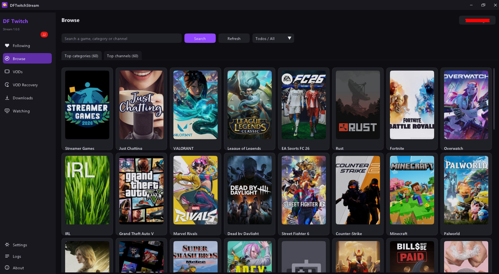

# DF Twitch Stream


https://github.com/user-attachments/assets/278cb5ff-e4c4-4fac-9676-51f6e5ee5433


A desktop app for Windows that lets you watch Twitch without a browser.

Sign in with your Twitch account, see who is live, and watch the stream with
chat right next to the video — all in one window. It also finds and downloads
old broadcasts that Twitch no longer lists.

---

## Screenshots

<!-- Replace the links below with your own image URLs -->




---

## Download

**[Download the latest version](https://github.com/DevDuckFace/DFTwitchStream/releases/download/v1.2/DFTwitchStream-1.0.0-setup.exe)**

Run the installer and follow the steps. It asks whether you want English or
Portuguese, and it can put a shortcut on your desktop.

---

## What it does

**Watch streams**
Pick a channel and it plays inside the app, with live chat beside the video.
Choose the quality you want, go fullscreen, and use the controls under the
player.

**See who you follow**
Your followed channels appear with live previews, viewer counts, and how long
each stream has been running.

**Explore**
Browse the most watched categories and channels, or search for a game to find
who is streaming it right now. You can filter by language.

**Chat that looks right**
Emotes and badges show up as images, including emotes from 7TV, BetterTTV and
FrankerFaceZ — the ones most chats actually use.

**VODs and clips**
Browse any channel's past broadcasts and clips. Watch them in the app or save
them to your computer.

**Recover old broadcasts**
Twitch deletes VODs after a few weeks, but the files often stay online for a
while longer. Give the app a channel and a broadcast, and it will look for the
video and download it if it is still there.

---

## What you need

- Windows 10 or 11 (64-bit)

That is it. The video player is included, so there is nothing else to install.

**Optional:** install [ffmpeg](https://ffmpeg.org/download.html) if you want
downloads saved as MP4 files. Without it they are saved in another video format
that still plays fine.

---

## Getting started

1. Install and open the app.
2. Click **Sign in with Twitch**.
3. A short code appears. Open the page shown, type the code, and approve it.
4. That's it — your channels load automatically.

You can also skip signing in. You will not see your followed channels, but
searching, VODs and recovery still work.

---

## Where your files go

Downloads are saved to **Videos → DFTwitchStream** by default. You can change
this in Settings.

Your login is stored on your own computer in encrypted form, and is never sent
anywhere except to Twitch.

---

## Building it yourself

You need Visual Studio (with C++), CMake and Git. Then run:

```bash
build.bat installer
```

This builds the app and creates the installer in the `dist` folder.

---

## Notes

This project is not made by, affiliated with, or endorsed by Twitch. Please use
it for content you are allowed to watch and keep, and respect Twitch's terms and
the people who make the streams.

Released under the MIT License — see [LICENSE](LICENSE).
